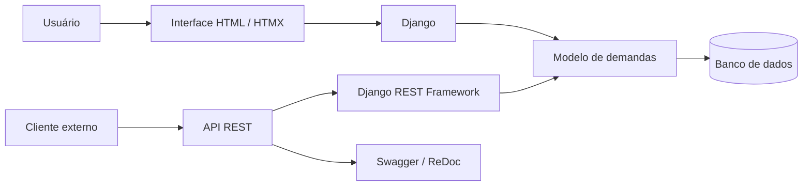

# Demando

Aplicação web para gestão de demandas e tarefas, construída com Django e uma API REST documentada.

O projeto concentra-se em um problema recorrente de sistemas de trabalho: registrar responsabilidades, acompanhar o estado das demandas e oferecer diferentes superfícies de uso sem duplicar a lógica central.

## Em um minuto: problema, solução e evidências

- **Problema:** gerir demandas por interface web e API sem duplicar a lógica de domínio.
- **Escopo do projeto:** aplicação pública de estudo aplicado; sem alegações de adoção comercial.
- **Solução documentada:** aplicação Django com autenticação, operações de demandas, API REST e documentação interativa.
- **Tecnologias:** Python, Django, Django REST Framework, HTMX, SQLite e Swagger/ReDoc.
- **Resultado verificável:** estrutura de aplicação, dependências em [requirements.txt](requirements.txt) e rotas de documentação descritas neste README. Não há resultado operacional quantificado.

**Como verificar:** examine `demandas/`, `demando/` e inicie o servidor local conforme os passos abaixo.

## Visão do sistema

Demando combina:

- interface web para operação cotidiana;
- autenticação de usuários;
- criação, edição e conclusão de demandas;
- API REST para integração;
- documentação interativa dos endpoints;
- área administrativa fornecida pelo ecossistema Django.

## Arquitetura



## Stack

**Aplicação**  
`Python 3.10` · `Django 5.1` · templates Django · `HTMX`

**API**  
`Django REST Framework` · `drf-yasg` · Swagger · ReDoc

**Persistência e configuração**  
`SQLite` · `python-dotenv`

## Capacidades

- cadastro, login e logout;
- criação e edição de demandas;
- conclusão e exclusão de tarefas;
- visualização organizada dos registros;
- API REST para acesso programático;
- documentação navegável da API;
- administração do sistema;
- interface adaptável para desktop e dispositivos móveis.

## Estrutura

```text
/
├── demandas/
│   ├── migrations/       # evolução do schema
│   ├── templates/        # interface web
│   ├── urls.py           # rotas do domínio
│   └── views.py          # comportamento da aplicação
├── demando/
│   ├── settings.py       # configuração
│   └── urls.py           # composição das rotas
├── requirements.txt
└── manage.py
```

## Execução local

```bash
git clone https://github.com/BrunoCesarAngst/demando.git
cd demando
python3 -m venv .venv
source .venv/bin/activate
pip install -r requirements.txt
```

Crie um arquivo `.env`:

```env
AMBIENTE=desenvolvimento
SECRET_KEY=defina-uma-chave-local
DEBUG=True
```

Prepare o banco e inicie a aplicação:

```bash
python manage.py migrate
python manage.py createsuperuser
python manage.py runserver
```

Aplicação: `http://127.0.0.1:8000/`

## Documentação da API

- Swagger UI: `http://127.0.0.1:8000/swagger/`
- ReDoc: `http://127.0.0.1:8000/redoc/`

A documentação interativa permite inspecionar contratos e testar endpoints durante o desenvolvimento.

## Decisões de engenharia demonstradas

- uma camada de domínio atendendo interface e API;
- rotas separadas por responsabilidade;
- migrações versionadas para evolução dos dados;
- configuração sensível fora do código;
- documentação gerada a partir da API;
- uso da administração do Django como ferramenta operacional;
- possibilidade de evolução gradual do front-end sem substituir o back-end.

## Possíveis evoluções

- substituir SQLite por PostgreSQL em ambientes compartilhados;
- introduzir testes automatizados de domínio e API;
- adicionar filtros, prioridades e responsáveis;
- criar trilha de auditoria para mudanças de estado;
- modelar permissões mais granulares;
- preparar execução conteinerizada.

## Estado do projeto

Projeto público de portfólio e estudo aplicado. Seu valor principal está em demonstrar organização de domínio, API documentada e uso integrado do ecossistema Django.

---

[Perfil de Bruno César Angst](https://github.com/BrunoCesarAngst) · [Site](https://brunoangst.com.br/)
